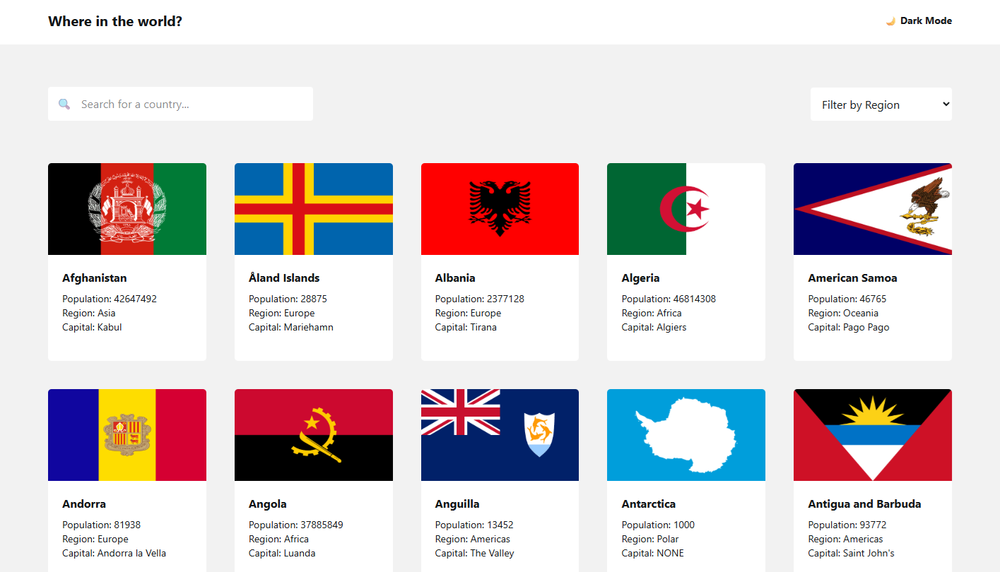

# Where in the world?

A country browser built as a Frontend Mentor challenge (REST Countries API with
color theme switcher). Browse countries, search and filter them, and view
detailed information about each one.



**Live demo:** https://rest-countries-api-with-color-theme-rho.vercel.app

## Features
- Browse all countries with flag, population, region and capital
- Search countries by name
- Filter countries by region
- Country detail page with links to neighbouring (border) countries
- Light / dark theme switcher
- Responsive layout (mobile, tablet, desktop)

## Built with
- React
- TypeScript
- Tailwind CSS
- React Router
- Vite

## Getting started

```bash
git clone https://github.com/Trueraqe/rest-countries-api-with-color-theme-switcher-master.git
cd rest-countries-api-with-color-theme-switcher-master
npm install
npm run dev
```

## What I learned
- [A concrete problem you solved, e.g. combining search and region filtering in one place]
- [Something about routing, e.g. building the country detail page with React Router]
- [Something about layout, e.g. making the grid responsive with Tailwind]

## Author
[Trueraqe](https://github.com/Trueraqe)